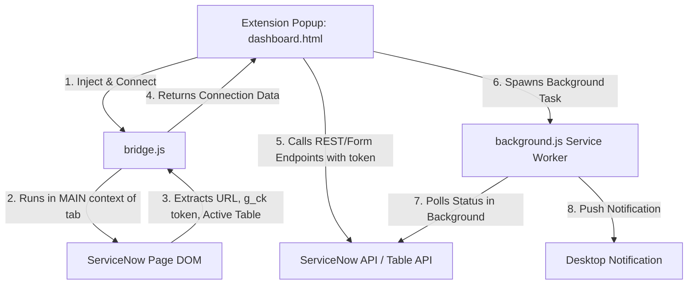

# Code Quality Audit Report: ServiceNow Live Companion

This audit report evaluates the code quality, logical correctness, and security posture of the **ServiceNow Live Companion** Chrome Extension based on the active files in the workspace. It aims to explain how the application works under the hood and identify potential risk areas.

---

## 1. Application Overview & How It Works

**ServiceNow Live Companion** is a Chrome Extension designed to enhance the ServiceNow developer experience by interacting with the active ServiceNow tab.

### Data Flow & Architecture


1. **The Bridge (`bridge.js`):** When you click "Initialize Bridge" in the popup, the extension queries Chrome tabs to find the active ServiceNow tab. It then injects `_extractSnowData` into the page's **MAIN execution world**. This allows the extension to bypass typical content script isolation and scrape page-level global variables like `window.g_ck` (the CSRF token required for ServiceNow REST calls), `window.g_form` (current record details), or URLs.
2. **API Layer (`api.js`):** Once connected, the popup can make authenticated requests directly to the ServiceNow REST APIs (`/api/now/...`) and internal endpoints by appending the captured token as the `X-UserToken` header.
3. **Background Worker (`background.js`):** For asynchronous tracking (e.g., flow contexts), the popup delegates polling to a persistent service worker. The worker periodically queries the status and fires Chrome desktop notifications when the execution status changes.

---

## 2. Key Code Quality Findings

During our audit, we identified several structural anomalies, logical bugs, and security risks.

### 🔴 High/Critical Risks

#### 1. Cross-Site Scripting (XSS) via Unsanitized `innerHTML` (Boundary Conditions / Security Injection)
In [dashboard.js](file:///c:/Users/MahmoudQandeel/OneDrive%20-%20Plat4mation/Desktop/SNOW_XML_PERIUEMEM_TOOL/js/dashboard.js), server data is directly rendered into the DOM using `innerHTML` without sanitization. If an instance contains malicious records, this could allow arbitrary code execution in the context of the extension popup.
- **Location 1:** [dashboard.js:L124](file:///c:/Users/MahmoudQandeel/OneDrive%20-%20Plat4mation/Desktop/SNOW_XML_PERIUEMEM_TOOL/js/dashboard.js#L124)
  ```javascript
  li.innerHTML = `<strong>${user.name}</strong> (${user.user_name})`;
  ```
- **Location 2:** [dashboard.js:L429-L433](file:///c:/Users/MahmoudQandeel/OneDrive%20-%20Plat4mation/Desktop/SNOW_XML_PERIUEMEM_TOOL/js/dashboard.js#L429-L433)
  ```javascript
  div.innerHTML = `
      <span class="log-meta">${time} | Source: ${source}</span>
      <span class="${levelClass}">[${levelText}]</span> ${message}
  `;
  ```
- **Recommendation:** Use `textContent` for dynamic values or escape HTML characters prior to insertion.

#### 2. Service Worker Termination in MV3 Background Polling (Concurrency / Resource Management)
In [background.js](file:///c:/Users/MahmoudQandeel/OneDrive%20-%20Plat4mation/Desktop/SNOW_XML_PERIUEMEM_TOOL/js/background.js), the background worker uses `setTimeout` to schedule the next status poll:
- **Location:** [background.js:L50](file:///c:/Users/MahmoudQandeel/OneDrive%20-%20Plat4mation/Desktop/SNOW_XML_PERIUEMEM_TOOL/js/background.js#L50)
  ```javascript
  setTimeout(checkStatus, 5000); 
  ```
- **Problem:** Manifest V3 service workers are short-lived and will shut down if there is no active event loop activity. `setTimeout` does not keep the service worker alive. If the worker terminates, background flow tracking stops completely.
- **Recommendation:** Re-architect background polling using `chrome.alarms` which safely wakes up the service worker to run periodic checks.

---

### 🟡 Medium Risks

#### 3. Broken API Contract for Update Set Fetching (API Contracts / Logic Errors)
In [dashboard.js](file:///c:/Users/MahmoudQandeel/OneDrive%20-%20Plat4mation/Desktop/SNOW_XML_PERIUEMEM_TOOL/js/dashboard.js), searches for update sets call `SNOW_API.fetchUpdateSets` with search parameters:
- **Location 1:** [dashboard.js:L204](file:///c:/Users/MahmoudQandeel/OneDrive%20-%20Plat4mation/Desktop/SNOW_XML_PERIUEMEM_TOOL/js/dashboard.js#L204)
  ```javascript
  const results = await window.SNOW_API.fetchUpdateSets(currentScopeId, term, 20);
  ```
- **Location 2:** [dashboard.js:L257](file:///c:/Users/MahmoudQandeel/OneDrive%20-%20Plat4mation/Desktop/SNOW_XML_PERIUEMEM_TOOL/js/dashboard.js#L257)
  ```javascript
  const updateSets = await window.SNOW_API.fetchUpdateSets(scopeId, "", 20);
  ```
- **Problem:** However, [api.js:L70](file:///c:/Users/MahmoudQandeel/OneDrive%20-%20Plat4mation/Desktop/SNOW_XML_PERIUEMEM_TOOL/js/api.js#L70) defines `fetchUpdateSets` to only accept a single argument (`scopeId`):
  ```javascript
  fetchUpdateSets: async function (scopeId) { ... }
  ```
  Consequently, searching for update sets on the server is completely broken; the query parameter and the limit arguments are ignored, resulting in a static return of up to 100 updates.

#### 4. Duplicate / Dead Code Components (Maintainability)
- **Duplicate Dictionary Export Method:** [api.js](file:///c:/Users/MahmoudQandeel/OneDrive%20-%20Plat4mation/Desktop/SNOW_XML_PERIUEMEM_TOOL/js/api.js) defines `exportDictionary` twice: once on line 116 using `GlideTableHierarchy` (which utilizes inline javascript evaluator inside URL queries, blocked in newer ServiceNow releases) and again on line 153 using recursive table hierarchy REST queries. The second definition overrides the first, leaving dead code at lines 116-123.
- **Unused File `js/features.js`:** The file [features.js](file:///c:/Users/MahmoudQandeel/OneDrive%20-%20Plat4mation/Desktop/SNOW_XML_PERIUEMEM_TOOL/js/features.js) implements duplicates of several `SNOW_API` methods (e.g. user search, impersonation, update set fetching). However, it is never imported in [dashboard.html](file:///c:/Users/MahmoudQandeel/OneDrive%20-%20Plat4mation/Desktop/SNOW_XML_PERIUEMEM_TOOL/dashboard.html) and remains completely unused.

---

### 🟢 Low Risks / Code Smells

#### 5. Injection Vulnerability in User Search Encoded Query (Security Injection)
In [api.js:L27](file:///c:/Users/MahmoudQandeel/OneDrive%20-%20Plat4mation/Desktop/SNOW_XML_PERIUEMEM_TOOL/js/api.js#L27):
```javascript
const query = `nameLIKE${searchTerm}^ORemailLIKE${searchTerm}^active=true`;
```
- **Risk:** Directly interpolating user input into the query string before encoding allows users to inject query control operators (like `^` or `=`) which could bypass search restrictions or return unintended users.
- **Mitigation:** Sanitize or strip query control characters (`^`, `=`) from the user input prior to string interpolation.

#### 6. Repeated Event Listener Bindings (State Management)
In [dashboard.js:L74-L76](file:///c:/Users/MahmoudQandeel/OneDrive%20-%20Plat4mation/Desktop/SNOW_XML_PERIUEMEM_TOOL/js/dashboard.js#L74-L76):
```javascript
flowSysIdInput.addEventListener('input', (e) => { ... });
```
- **Problem:** This listener is defined inside the connection button click handler. If a user connects, disconnects, or retries connection, new listeners are bound continuously to the same input element, leading to memory leaks and multiple duplicate triggers.

---

## 3. Risk Summary Table

| Category | Finding / Location | Severity | Impact |
| :--- | :--- | :--- | :--- |
| **Security Injection** | DOM XSS via unsanitized `innerHTML` ([dashboard.js](file:///c:/Users/MahmoudQandeel/OneDrive%20-%20Plat4mation/Desktop/SNOW_XML_PERIUEMEM_TOOL/js/dashboard.js)) | 🔴 High | Malicious data could execute arbitrary code in extension popup context. |
| **Concurrency** | Service worker lifecycles with `setTimeout` ([background.js](file:///c:/Users/MahmoudQandeel/OneDrive%20-%20Plat4mation/Desktop/SNOW_XML_PERIUEMEM_TOOL/js/background.js)) | 🔴 High | Background Flow Tracking shuts down prematurely when browser suspends the worker. |
| **API Contracts** | Broken parameter signature on `fetchUpdateSets` ([api.js](file:///c:/Users/MahmoudQandeel/OneDrive%20-%20Plat4mation/Desktop/SNOW_XML_PERIUEMEM_TOOL/js/api.js)) | 🟡 Medium | Live searching of update sets fails to filter on the server. |
| **Maintainability** | Duplicate code, dead methods, and unused files ([api.js](file:///c:/Users/MahmoudQandeel/OneDrive%20-%20Plat4mation/Desktop/SNOW_XML_PERIUEMEM_TOOL/js/api.js), [features.js](file:///c:/Users/MahmoudQandeel/OneDrive%20-%20Plat4mation/Desktop/SNOW_XML_PERIUEMEM_TOOL/js/features.js)) | 🟡 Medium | Bloats payload size and degrades developer maintainability. |
| **Security Injection** | Unsanitized query string injection in user search ([api.js](file:///c:/Users/MahmoudQandeel/OneDrive%20-%20Plat4mation/Desktop/SNOW_XML_PERIUEMEM_TOOL/js/api.js)) | 🟢 Low | Query syntax injection can alter search filters on `sys_user` query. |
| **State Management** | Multi-binding event listeners on reconnects ([dashboard.js](file:///c:/Users/MahmoudQandeel/OneDrive%20-%20Plat4mation/Desktop/SNOW_XML_PERIUEMEM_TOOL/js/dashboard.js)) | 🟢 Low | Possible event handler overhead and memory leaks. |
